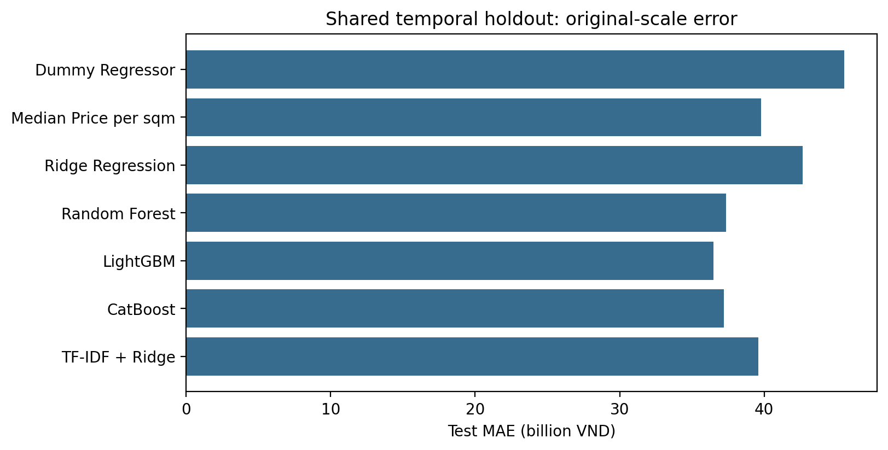

# Model training results

Input: `data/processed/experiment_cohort.parquet` (SHA-256 `fed76e7d6af7d8adebd00e0a8e2d7029d575f56048131806314b5186088464a1`).
All **59,519 already preprocessed rows** were used.
The training workflow does not download, inspect raw sources, clean, sample, deduplicate,
or overwrite the supplied dataset. EDA and dataset preparation belong to `notebooks/`.

## Training configuration

- Split: existing split column (unchanged).
- Training / validation / test: 41,663 / 8,928 / 8,928.
- Split fingerprint: `0a9c1f107e0483f3d08c54f25982f7b35f7222089dab4824eb568b26a2c93a52`.
- Imputation, encoding, scaling, group medians, and TF-IDF are fitted using training data.
- Validation MAE selects hyperparameters. Boosting early stopping uses validation log-RMSE.
- Nonbaseline models fit log1p prices and return original-scale predictions, bounded by
  the maximum training price. Models are not refitted on validation data.

## Test results

| Model | MAE (VND) | RMSE (VND) | R² | MAPE (%) |
|---|---:|---:|---:|---:|
| Dummy Regressor | 45,548,775,416 | 2,966,493,482,061 | -0.0001 | 259.20 |
| Median Price per sqm | 39,768,818,191 | 2,968,655,086,029 | -0.0016 | 44.85 |
| Ridge Regression | 42,681,233,989 | 2,971,055,734,676 | -0.0032 | 74.73 |
| Random Forest | 37,358,517,200 | 2,965,843,657,508 | 0.0003 | 36.77 |
| LightGBM | 36,477,344,778 | 2,964,995,648,314 | 0.0009 | 28.59 |
| CatBoost | 37,207,498,640 | 2,964,647,677,804 | 0.0011 | 35.56 |
| TF-IDF + Ridge | 39,616,175,623 | 2,966,358,669,831 | -0.0000 | 54.23 |

MAE and RMSE are in VND. R-squared is unitless and MAPE is a percentage. Metrics use every
held-out row. The largest recorded test price is **280,280,000,000,000 VND**;
its squared-error contribution ranges from **99.67%** to
**99.99%** across the seven models. Recorded asking prices
may contain errors; the training workflow does not change their values.

## Validation and input availability

All seven notebooks executed from beginning to end with real results, rendered tables,
and diagnostic figures. Prediction row alignment, target values, file checksums, finite
metrics, and identical split membership passed the final audit.

This run uses the existing processed cache, read unchanged. The EDA export priced_listings.parquet was not the input for this run; the results validate training on the supplied cache. When the EDA output exists, it becomes the default input; select an
explicit `DATA_PATH` or `EXPERIMENT_DATA_PATH` to control the input across runs.

See [EXPERIMENTS.md](../../EXPERIMENTS.md) for the training commands and data contract.
